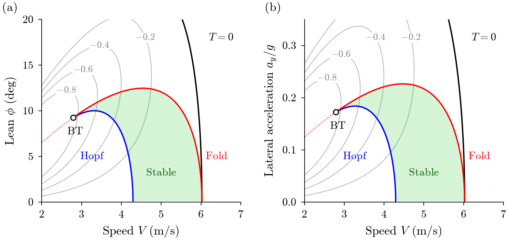

# Stability of steady turns of the Whipple bicycle

This code computes the steady turns of the nonlinear Whipple bicycle with a constant steer torque and their stability. The stable turns fill a tongue-shaped region in the plane of speed and lean, between a weave Hopf curve and a fold curve that meet at a Bogdanov-Takens point. The scripts reproduce the figures and the main numbers of the paper for the benchmark bicycle of Meijaard et al. (2007) and for two city bicycles A and B that differ only in the front-frame pitch inertia.



## Install

The project uses [uv](https://docs.astral.sh/uv/) and runs on Python 3.10 or newer.

```
uv sync
```

## Run

```
uv run python scripts/tongue.py
uv run python scripts/tongue.py --quick
uv run pytest
```

Each script writes its figures (PDF and PNG) and a small JSON file of numbers to `results/`. The option `--quick` uses coarser steps and grids. Each run first derives the equations of motion with SymPy, which takes a few seconds.

| Script | Paper result |
| --- | --- |
| `torque_map.py` | Fig. 1, steer torque over speed and lateral acceleration, peak of the hands-free curve |
| `eigenvalues_vs_speed.py` | Fig. 2, eigenvalues over speed at four leans |
| `capsize_condition.py` | Eq. (10), capsize condition in a turn at random steady turns |
| `lean_law.py` | Fig. 5, Tables C1 and C2, small-lean expansion of the eigenvalues |
| `tongue.py` | Figs. 3 and 7, Tables 1 and D2, region of stable turns of the benchmark bicycle and bicycles A and B |
| `constant_wheel_speed.py` | Fig. 4a, Table 1, turns with the rear-wheel speed held |
| `franke_offset.py` | Fig. 4b, turns held by a lateral offset of the rear-frame mass centre |
| `period_doubling.py` | Sect. 6, period doubling of the weave cycle at T = -0.418 N m |
| `pitch_inertia.py` | Sect. 7, effect of the frame pitch inertias |
| `lyapunov_coefficient.py` | Fig. 8, Sect. 7.3, first Lyapunov coefficient and the Bautin point of bicycle B |
| `hands_free_turns.py` | App. D, hands-free turns of Basu-Mandal et al. (2007) |
| `turn_entry.py` | Fig. D1, turn entry under a virtual rider |
| `weave_chaos.py` | Fig. 6b and 6c, lean maxima and Lyapunov exponent of the weave below the Hopf curve |
| `real_bikes.py` | Fig. H1, Table H1, tongues of the 13 parameter sets in BicycleParameters |
| `tyre_tongue.py` | Fig. F1, tyre-slip tongue on Magic Formula tyres, rear-wheel speed held |

The package `whipple/` holds the model (`model.py`), the linear upright model (`linear.py`), the stability analysis (`stability.py`), the small-lean expansion of the eigenvalues (`lean_law.py`), the weave beyond the Hopf curve (`weave.py`), the tyre model (`tyre.py`), the virtual rider (`rider.py`), the bicycle parameters (`bicycles.py`, `data/`) and the figure style (`plotstyle.py`).

The folder `c/` holds a compiled OpenMP batch program for the weave below the Hopf curve: 4220 levels with 3000 s each, as in Fig. 6b and 6c. Build it with

```
gcc -O3 -march=native -fopenmp hires.c engine_model.c _generated.c -lm -o hires
./hires levels_example.txt out.txt 0.008 600 3000 0.5 1
```

The level file has the format given at the top of `hires.c`. `levels_example.txt` holds six levels of the benchmark bicycle.

## Conventions

The axes and signs follow Meijaard et al. (2007): x forward, y to the right, z down, and positive lean and steer to the right. The speed V and the radius R of a turn are those of the rear contact point. The lateral acceleration is a_y = V Omega, with Omega the yaw rate. The state is (lean, steer, lean rate, steer rate, s), with s the spin rate of the rear wheel relative to the rear frame. Forward running has s < 0.

## License and citation

MIT License, see `LICENSE`.

R. Wydaeghe, Stability of steady turns of the Whipple bicycle, in preparation (2026).
